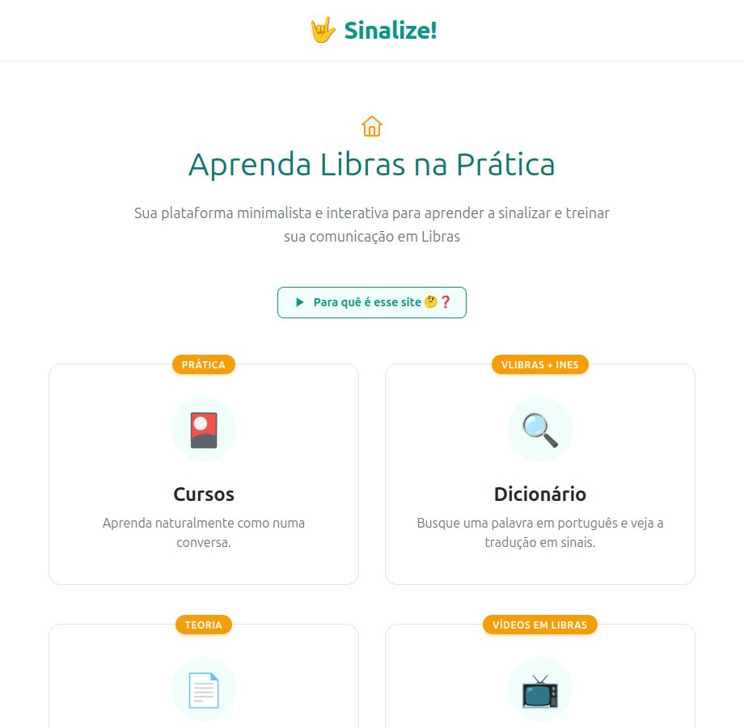

# Sinalize! 🤟

> Sua plataforma minimalista e interativa para aprender a sinalizar e treinar sua comunicação em Libras — de graça.

Sumário:

1. [Sobre](#sobre)
2. [Funcionalidades](#funcionalidades)
3. [Captura de tela](#captura-de-tela)
4. [Stack](#stack)
5. [Como rodar](#como-rodar)
6. [Estrutura do projeto](#estrutura-do-projeto)
7. [Onde editar conteúdo](#onde-editar-conteúdo)
8. [Deploy](#deploy)
9. [Contribuindo](#contribuindo)
10. [Licença](#licença)

## Sobre

O projeto surgiu com vários pedidos para ensinar como conversar com Surdos. Há milhões de surdos no Brasil, e muitos deles usam Libras. Existem sites que ensinam Libras, mas a maioria é difícil de usar: são só cursos, só dicionários — ou são pagos.

Este site é para todos que quiserem estar prontos para uma conversa básica com Surdos, de graça.

## Funcionalidades

| Área | O que faz |
| :--- | :--- |
| **Cursos** (`/courses`) | Módulos de vídeo-aulas curtinhas, cada aula com vídeo + atividade de flashcards (texto em português ↔ vídeo em Libras). |
| **Dicionário** (`/dictionary`) | Digite uma palavra em português e veja o sinal correspondente em vídeo (dados do Acessibilidade Brasil), com o widget VLibras como apoio. |
| **Artigos** (`/articles-list`) | Artigos teóricos em português, renderizados a partir de arquivos Markdown. |
| **Pura Libras** (`/puralibras`) | Biblioteca de vídeos curados no YouTube, com filtros por tags (Com Legenda, Mão Surd@, Com Áudio). |

A acessibilidade é parte central: o site inclui o widget **VLibras** (gov.br) em todas as páginas, além de textos alternativos, `aria-labels` e navegação por teclado.

## Captura de tela



## Stack

| Camada | Tecnologia |
| :--- | :--- |
| UI | [React 19](https://react.dev) + [TypeScript](https://www.typescriptlang.org) |
| Build | [Vite 8](https://vite.dev) |
| Estilos | [Tailwind CSS v4](https://tailwindcss.com) |
| Rotas | [React Router v7](https://reactrouter.com) |
| Artigos | [react-markdown](https://github.com/remarkjs/react-markdown) + [remark-gfm](https://github.com/remarkjs/remark-gfm) |
| Vídeos | Cloudflare R2 (bucket público) |
| Deploy | [Vercel](https://vercel.com) |

Projeto criado a partir do template oficial do Vite (React + TypeScript). A validação é feita com `npm run lint` (ESLint) e `npm run build` (TypeScript + Vite).

## Como rodar

Pré-requisito: **Node.js 20.19+** (ou **22.12+**, exigência do Vite 8).

```bash
# 1. Instale as dependências
npm install

# 2. Suba o servidor de desenvolvimento
npm run dev
# → provavelmente em http://localhost:5173/
```

> ⚠️ **Portas e CORS:** somente algumas portas estão liberadas para os testes com os vídeos; a `5173` é uma delas. Se o Vite subir em outra porta (porque a 5173 está ocupada), os vídeos podem ser barrados pelo CORS.

Outros scripts:

| Comando | O que faz |
| :--- | :--- |
| `npm run lint` | Roda o ESLint em todo o projeto. |
| `npm run build` | Checa os tipos (`tsc -b`) e gera o build de produção em `dist/`. |
| `npm run preview` | Serve o build de produção localmente. |

## Estrutura do projeto

```text
src/
├── pages/            # uma página por rota (Header + Footer + conteúdo)
├── home/             # grade de navegação da home
├── courses/          # listagem de módulos
├── class-study/      # página da aula (vídeo + flashcards)
├── dictionary/       # busca de sinais no dicionário
├── pura-libras/      # biblioteca de vídeos curados
├── articles/         # lista e leitura de artigos (Markdown)
├── shared/           # componentes reutilizáveis (Header, Footer, NavCard,
│                     #   Flashcard, VideoExplainer, SearchBar…)
├── hooks/            # leitura e filtragem dos JSONs de conteúdo
├── types/            # interfaces TypeScript dos dados
└── assets/           # conteúdo (JSONs) e imagens
```

## Onde editar conteúdo

O "CMS" do site são arquivos JSON em `src/assets/` e arquivos Markdown em `src/articles/articles-md/`:

| Arquivo | Conteúdo |
| :--- | :--- |
| `src/assets/modules.json` | Módulos e aulas: título, descrição, vídeo de introdução e lista de aulas (`videoId` + `flashcardId`s). |
| `src/assets/flashcards.json` | Cartões de estudo: texto em português, arquivo de vídeo em Libras e tags. |
| `src/assets/curated_videos.json` | Vídeos da seção Pura Libras: título, URL, thumbnail, duração e tags. |
| `src/assets/videos_map.json` | Mapa palavra → ID do vídeo do dicionário (5.400+ palavras). |
| `public/videos_map.json` | Cópia servida em runtime (`/videos_map.json`). Mantenha as duas em sincronia. |
| `src/articles/articles-md/*.md` | Artigos: o nome do arquivo é o título exibido na lista. |

**Vídeos:** ficam no bucket público do Cloudflare R2 `pub-53c058da4b9543a8b580f5adffb6a867.r2.dev`, nas pastas `module-intro_videos/` (intro dos módulos), `classes_videos/` (aulas, por `videoId`), `flashcard-page/` (flashcards), `sinalize-public-project/` (dicionário) e `how-to_videos/` (tutoriais "como usar").

## Deploy

O deploy é feito na **Vercel** em [https://sinalize.org](https://sinalize.org). O arquivo `vercel.json` configura `cleanUrls` e redireciona todas as rotas para `/`, o que dá suporte ao roteamento do SPA (links profundos como `/classes?moduleId=1&videoId=101` funcionam ao recarregar a página).

## Contribuindo

Sugestões, correções de conteúdo e novos artigos são muito bem-vindos:

- Abra uma [issue](https://github.com/thalesmenegueco/sinalize/issues) para bugs, ideias ou erros de sinalização;
- Envie um Pull Request — para conteúdo, cite a fonte (por exemplo, dicionários oficiais ou profissionais surdos).

## Licença

Ainda não definida. Se você pretende reutilizar os vídeos ou os textos, abra uma issue para conversarmos.
